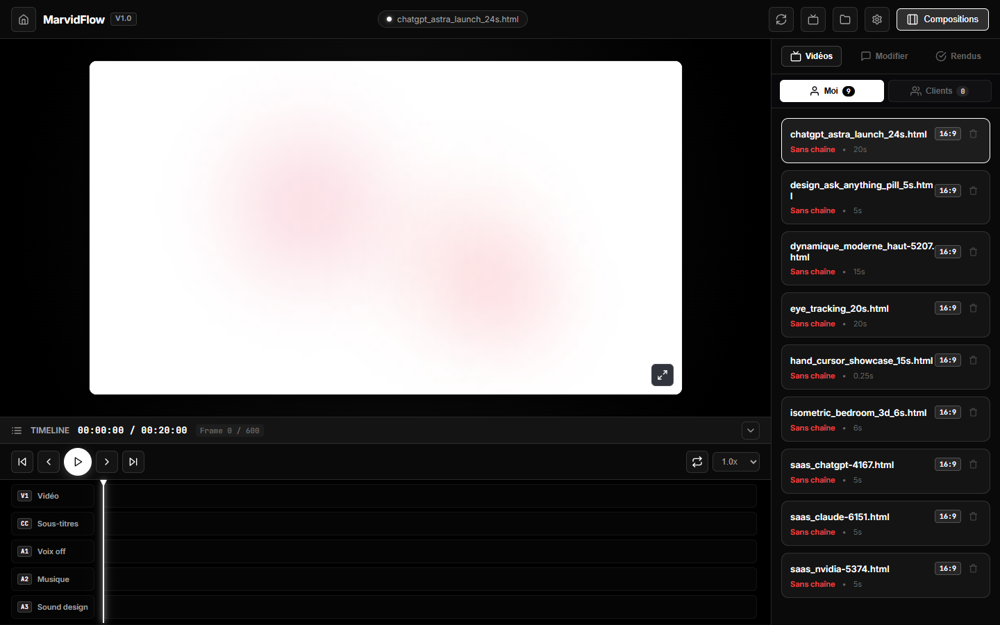
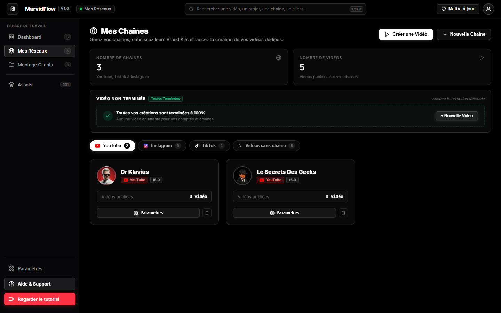
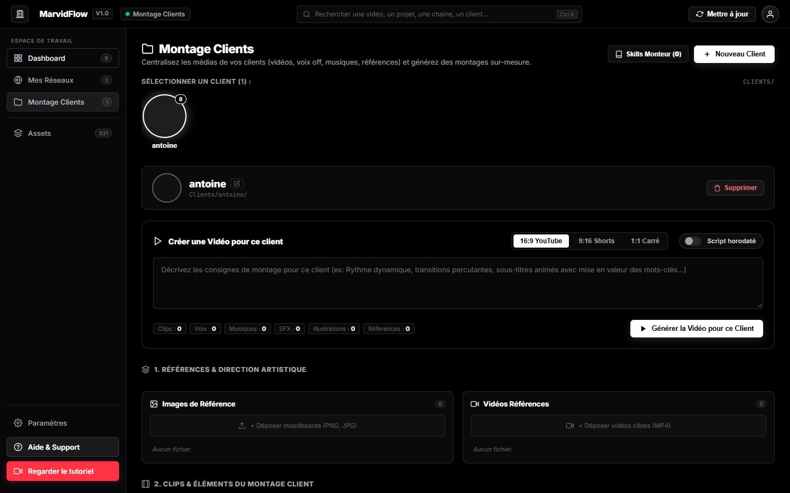
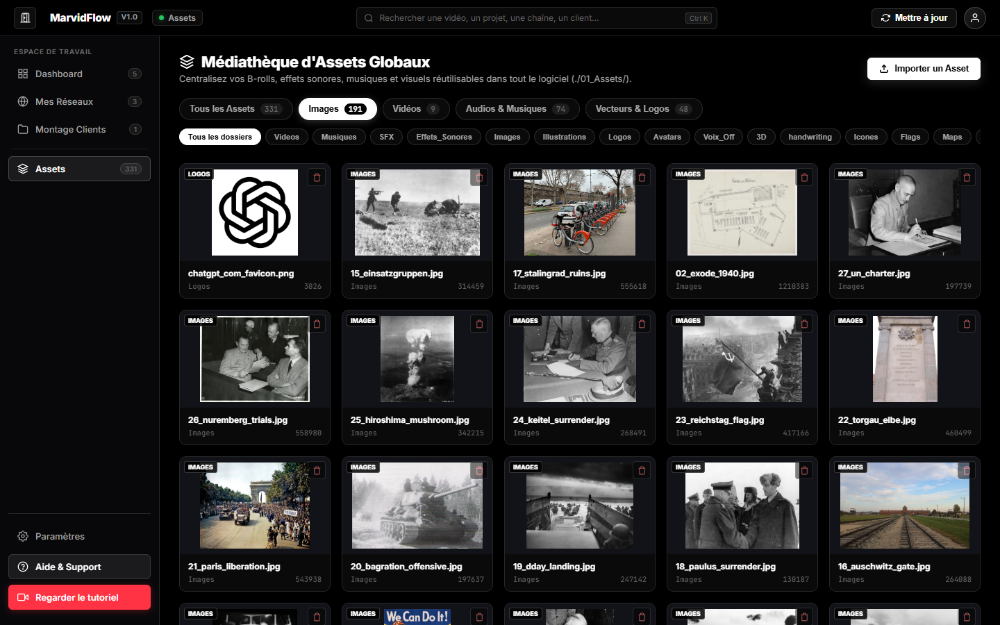

<p align="center">
  
</p>

<h1 align="center">MarvidFlow</h1>

<p align="center">
  <strong>Studio de production et d'automatisation vidéo assisté par IA</strong><br>
  <em>De l'idée brute au rendu MP4 60 FPS : génération de scénarios, voix off, animations motion design GSAP/Three.js, sous-titrage synchronisé et traitement automatique de rushs (TikTok, Reels, YouTube Shorts & YouTube).</em>
</p>

<p align="center">
  
  
  
  
  
  
</p>

> [!IMPORTANT]
> **Projet en cours de développement (Work in Progress)** :  
> MarvidFlow n'est pas encore terminé à 100 %. Je prépare actuellement un examen important, mais je compte reprendre le développement activement et finaliser l'application le plus rapidement possible juste après !  
> En attendant, le projet est déjà fonctionnel en local et reste entièrement **Open Source** pour celles et ceux qui souhaitent le tester, l'explorer ou y contribuer.

---

## 📸 Aperçu de l'interface

### Tableau de bord principal


---

## 💡 Qu'est-ce que MarvidFlow ?

MarvidFlow est un studio web local pensé pour automatiser les tâches répétitives de création et de post-production vidéo grâce aux technologies web modernes (HTML5, Canvas, GSAP, Three.js) et à un pipeline automatisé.

1. **Création de vidéos à partir d'un prompt ou d'un script** : Génération de compositions animées à 60 FPS avec voix off, sous-titres synchronisés mot à mot, B-rolls, cartes animées, graphiques et scènes 3D.
2. **Montage et préparation de rushs Clients** : Espace dédié pour centraliser les vidéos brutes d'un client, couper les silences, supprimer les mauvaises prises, recadrer en 9:16 et préparer l'export.
3. **Prévisualisation Studio & Export MP4** : Lecteur haute précision image par image permettant d'inspecter les pistes de la timeline et d'exporter les compositions en fichier MP4 final sans perte.

---

## 🚀 Installation et démarrage (Dépôt Node.js)

### 1. Cloner le projet et installer les paquets Node.js

```bash
# 1. Cloner le dépôt
git clone https://github.com/NdarawFall/MarvidFlow.git
cd MarvidFlow

# 2. Installer les dépendances JavaScript
npm install
```

### 2. Lancer l'application

```bash
npm start
# ou
npm run studio
```

Le serveur local démarre et ouvre automatiquement votre navigateur sur :  
👉 **`http://localhost:3000/09_Pages/home.html`**

---

## 🧰 Outils & Dépendances externes à installer

En plus de `npm install`, MarvidFlow s'appuie sur plusieurs outils externes selon les modules que vous souhaitez utiliser ou tester :

| Outil / Programme | Statut | Rôle & Installation |
| :--- | :--- | :--- |
| **Node.js (v18+)** | **Obligatoire** | Fait tourner le serveur local (`studio-server.cjs`) et les scripts Node.<br>[Télécharger Node.js](https://nodejs.org/) |
| **Google Chrome / Edge** | **Obligatoire** | Utilisé pour afficher le Studio et piloter le rendu vidéo headless à 60 FPS (`render.cjs` via CDP). |
| **FFmpeg** | **Requis** *(Pré-inclus)* | Encodage vidéo H.264/AAC, découpe des silences, recadrage 9:16 et mixage audio -14 LUFS.<br>*(Inclus automatiquement via `@ffmpeg-installer/ffmpeg` lors du `npm install`, mais une installation globale dans votre `PATH` est également supportée.)* |
| **Python (3.8+) & paquets** | **Recommandé** | Nécessaire pour la voix off gratuite **Edge TTS**, le téléchargement YouTube (**yt-dlp**) et la synthèse sonore (**numpy / scipy**). |
| **Blender (3.6 LTS+)** | *Optionnel* | Utilisé uniquement sur demande explicite pour convertir/optimiser des modèles `.blend` / `.fbx` / `.obj` en `.glb` pour Three.js (`blender_tool.cjs`). |

### Installation groupée des outils Python (Voix gratuite, Musique, SFX & YouTube)

Si vous souhaitez activer la voix off **100 % gratuite** (Edge TTS), les bruitages/musiques procéduraux et l'import d'extraits YouTube :

```bash
# Voix off neuronale gratuite (sans clé API)
pip install edge-tts

# Téléchargement d'extraits YouTube, miniatures & transcriptions
pip install yt-dlp

# Synthèse procédurale de musiques et d'effets sonores (SFX)
pip install numpy scipy
```

---

## 🖥️ Objectif Application Bureau (Electron) & Open Source

À terme, **je souhaite transformer MarvidFlow en une véritable application bureau autonome avec Electron** (installateur `.exe` / desktop sans avoir besoin d'ouvrir un terminal).

- Ce packaging final n'est **pas encore terminé** pour le moment, car je me concentre d'abord sur mon examen et la finalisation du cœur applicatif.
- Toutefois, la structure Electron (`electron-main.cjs` et `electron-builder` dans `package.json`) est déjà présente dans le dépôt.
- **Ce projet étant Open Source (licence MIT)**, si vous souhaitez tester la version bureau dès maintenant ou compiler votre propre exécutable Electron, vous pouvez tout à fait le faire librement :

```bash
# Lancer l'application en fenêtre bureau Electron
npm run desktop

# Compiler un exécutable / dossier distribuable Windows
npm run pack
# ou pour générer l'installeur NSIS (.exe) :
npm run dist
```

---

## ⚙️ Panorama des outils intégrés

MarvidFlow embarque une boîte à outils modulaire complète dans `07_Scripts/` :

- **🎙️ Synthèse Vocale (TTS)** : Double moteur **Edge TTS** *(Microsoft Neural, gratuit sans clé API)* et **ElevenLabs** *(clonage & voix studio)* avec écoute directe des voix dans l'interface.
- **🎬 Moteur d'Animation & 3D** : Compositions pilotées image par image via **GSAP 3.15**, **Three.js** (avec flou de mouvement caméra), génération procédurale d'objets 3D sans fichier externe (`image2threejs.cjs`), et écriture manuscrite vectorielle (**Tegaki**).
- **✂️ Traitement Automatique de Rushs** : Découpe automatique des silences (`cut_silences.cjs`), détection des hésitations/mauvaises prises (`detect_bad_takes.cjs`), recadrage intelligent 16:9 → 9:16 (`auto_reframe.cjs`), détourage IA (`remove_bg.cjs`) et chroma key (`chroma_key.cjs`).
- **🔊 Mixage Audio & Sound Design** : Création automatique de bandes-son avec ducking musical intelligent (`build_soundtrack.cjs`), normalisation broadcast **-14 LUFS** (`normalize_audio.cjs`), bruitages et musiques procédurales (`sfx.py`, `generate_music.py`, `fetch_sfx.cjs`).
- **🌍 Enrichissement Médias** : Extraction de vrais logos de marques (`brandfetch.cjs`), drapeaux (`fetch_flag.cjs`), cartes vectorielles animées (`fetch_map.cjs`), extraits/miniatures YouTube (`youtube_clip.cjs`), B-rolls (`coverr.cjs`) et modèles 3D `.glb` (`fetch_3d_model.cjs`).
- **💬 Sous-titrage Dynamique** : Alignement temporel et styles visuels prêts à l'emploi (`transcribe_subtitles.cjs` — styles Hormozi, Karaoké, Documentaire, Néon, Minimal).

---

## 📱 Découverte des écrans de l'application

### 1. Générateur de vidéo par IA (`#create_video`)
Configurez votre prompt ou script horodaté, sélectionnez le ratio (9:16, 16:9, 1:1), choisissez le style de montage, le moteur vocal et les sous-titres.


### 2. Studio de prévisualisation & Timeline (`studio.html`)
*(Note : à ce stade du développement, le Studio sert à **prévisualiser vos compositions image par image à 60 FPS, inspecter les 5 pistes et exporter vos rendus MP4** — l'assistant d'édition interactif par chat est en cours de finalisation).*



### 3. Mes Réseaux & Brand Kits (`#reseaux`)
Organisez vos chaînes YouTube, TikTok et Instagram avec leurs propres identités visuelles et typographies.



### 4. Espace Montage Clients (`#clients`)
Centralisez les rushs, voix off, musiques et moodboards de chaque client dans des dossiers isolés.



### 5. Médiathèque d'Assets Globaux (`#assets`)
Parcourez, prévisualisez et filtrez tous les médias locaux du studio (Images, Vidéos, Audios, Vecteurs, Modèles 3D, Cartes).



---

## 🔑 Configuration des clés API (Optionnel)

Vous pouvez explorer l'interface et générer des voix avec **Edge TTS** sans aucune clé API. Pour activer les moteurs IA externes et certaines banques médias, rendez-vous dans **Paramètres** (icône d'engrenage dans l'application) :

- **Google Gemini** (`google_api_key`) : Scénarisation & direction artistique ([Google AI Studio](https://aistudio.google.com/app/apikey)).
- **Groq / OpenRouter** (`groq_api_key`, `openrouter_api_key`) : Modèles rapides alternatifs (Llama 3.1, etc.).
- **ElevenLabs** (`elevenlabs_api_key`) : Voix off haute fidélité et suivi du quota de caractères.
- **Brandfetch / Pixabay / Coverr / Sketchfab** *(Optionnels)* : Logos vectoriels, B-rolls et modèles 3D.

> 🔒 **Confidentialité** : Vos clés restent strictement stockées en local dans `07_Scripts/api_config.json` (ignoré par `.gitignore` et jamais publié).

---

## 🛠️ Commandes utiles

```bash
# Démarrer le serveur web du studio
npm start
# ou
npm run studio

# Lancer le rendu MP4 d'une composition en ligne de commande
npm run render -- 04_Videos/ma_video.html

# Vérifier l'intégrité et la traçabilité de l'architecture
npm run check:arch

# Nettoyer les scripts temporaires dans scratch/
npm run clean:scratch

# Lancer en mode Electron Desktop
npm run desktop

# Compiler l'application Windows Electron
npm run dist
```

---

## 📁 Architecture complète du projet

```text
MarvidFlow/
├── package.json                        # Dépendances, scripts npm & configuration Electron Builder
├── electron-main.cjs                   # Point d'entrée Desktop Electron
├── .agents/
│   ├── rules/                          # Règles de gouvernance IA (architecture, matrice vidéo, rendu, sécurité)
│   └── skills/                         # Compétences vidéo avancées (Caméra, Three.js, GSAP, Curseur, Sound Design...)
├── 00_Skills/                          # Modules visuels spécialisés (Tegaki handwriting, CRT, Apple design, Stickman...)
├── 01_Assets/                          # Médiathèque locale organisée (3D, Audio_Mix, Avatars, Effets_Sonores, Flags,
│                                       #   Handwriting, Icones, Illustrations, Images, Logos, Maps, Musiques, Videos, Voix_Off)
├── 02_Composants/                      # Composants HTML/CSS réutilisables (Subtitles, Charts_Data, Counter, Lower_Thirds,
│                                       #   Mockups_Devices, Audio_Visualizer, Progress_Bar, Split_Screen, Transitions...)
├── 03_Chaines/                         # Dossiers et compositions dédiées par chaîne (Brand Kits inclus)
├── 04_Videos/                          # Compositions vidéo HTML autonomes (prêtes pour preview & export MP4)
├── 05_Scenes/                          # Scènes modulaires unitaires intermédiaires
├── 06_Templates/                       # Gabarits maîtres de production
├── 07_Scripts/                         # Moteurs serveur et scripts complets du pipeline :
│   ├── studio-server.cjs               # Serveur HTTP/REST local, gestionnaire de cache et routes API
│   ├── ai_director.cjs                 # Orchestrateur autonome de création vidéo IA
│   ├── ai_kombo.cjs                    # Routeur multi-modèles IA (Gemini, Groq, OpenRouter)
│   ├── render.cjs                      # Capture Chromium CDP 60 FPS + encodage MP4 FFmpeg
│   ├── roadmap_generator.cjs           # Générateur de feuille de route IA avant production
│   │
│   ├── generate_voice.cjs              # Synthèse vocale (Edge TTS gratuit & ElevenLabs)
│   ├── generate_music.py               # Génération procédurale de musiques de fond
│   ├── sfx.py                          # Génération procédurale de bruitages & SFX
│   ├── fetch_sfx.cjs                   # Recherche bruitages Openverse (CC0) & fallback procédural
│   ├── fetch_music.cjs                 # Téléchargement de musiques libres de droit
│   ├── build_soundtrack.cjs            # Mixage audio final avec ducking automatique (-14 LUFS)
│   ├── normalize_audio.cjs             # Normalisation audio EBU R128
│   ├── audio_sync_helper.js            # Synchronisation fine pistes audio / timeline
│   ├── transcribe_subtitles.cjs        # Génération & formatage de sous-titres synchronisés
│   │
│   ├── cut_silences.cjs                # Découpage automatique des silences (jump-cut)
│   ├── detect_bad_takes.cjs            # Détection et retrait des hésitations / bafouillages
│   ├── auto_reframe.cjs                # Recadrage automatique 16:9 -> 9:16
│   ├── remove_bg.cjs                   # Suppression de fond d'images par IA
│   ├── chroma_key.cjs                  # Incrustation fond vert vidéo
│   ├── record_web.cjs                  # Enregistrement vidéo de pages web dynamiques
│   │
│   ├── image2threejs.cjs               # Génération procédurale d'objets 3D Three.js sans GLB
│   ├── fetch_3d_model.cjs              # Téléchargement de modèles 3D .glb (Poly Haven / Khronos)
│   ├── blender_tool.cjs                # Passerelle CLI Blender -> .glb (sur demande explicite)
│   ├── blender_export_glb.py           # Script bpy d'optimisation et export glTF 2.0
│   ├── youtube_clip.cjs                # Extraction d'extraits YouTube calibrés, miniatures & transcripts
│   ├── coverr.cjs                      # Recherche et téléchargement de B-rolls HD/4K
│   ├── brandfetch.cjs                  # Extraction de logos vectoriels officiels de marques
│   ├── fetch_flag.cjs                  # Téléchargement de drapeaux mondiaux
│   ├── fetch_football_logo.cjs         # Téléchargement de logos de clubs de football
│   ├── fetch_sportsdb.cjs              # Téléchargement de portraits de joueurs & badges
│   ├── fetch_map.cjs                   # Cartographie vectorielle animée (TopoJSON)
│   ├── stitch_map.cjs                  # Assemblage de tuiles cartographiques HD
│   ├── generate_bg.cjs                 # Générateur d'arrière-plans animés CSS/Canvas
│   ├── build_icon.cjs                  # Construction d'icônes animées
│   │
│   ├── build_phone_video.cjs           # Pipeline vidéo format mockup smartphone
│   ├── build_top10_video.cjs           # Pipeline vidéo format Top 10 vertical (9:16)
│   ├── build_top10_16x9_video.cjs      # Pipeline vidéo format Top 10 horizontal (16:9)
│   ├── build_growkaw_video.cjs         # Pipeline formats Growth
│   ├── build_video_handwriting.cjs     # Pipeline vidéo écriture manuscrite
│   ├── build_ww2_documentary.cjs       # Pipeline documentaire long format
│   ├── generate_style_thumbnails.cjs   # Générateur de vignettes de styles
│   ├── generate_all_style_thumbnails.cjs # Batch de génération des vignettes
│   │
│   ├── check-architecture.cjs          # Gardien automatisé de conformité documentaire
│   ├── audit-build-security.cjs        # Audit de sécurité pré-build Electron
│   ├── cleanup-scratch.cjs             # Nettoyage des fichiers temporaires scratch/
│   ├── channels.json                   # Registre des chaînes utilisateur
│   └── api_config.example.json         # Modèle de configuration des paramètres & clés
├── 08_Rendus/                          # Sorties vidéo MP4 finales exportées (ignoré par Git)
├── 09_Pages/                           # Interface utilisateur web :
│   ├── home.html                       # Dashboard SPA (#dashboard, #reseaux, #clients, #assets, #create_video, #settings)
│   ├── studio.html                     # Visualiseur Studio, timeline multipiste et panneau Rendus
│   ├── create_video.html               # Formulaire autonome de création vidéo
│   ├── video_processus.html            # Suivi visuel en direct du pipeline IA
│   ├── createur.html                   # Espace gestion des chaînes / créateur
│   ├── monteur.html                    # Espace monteur
│   ├── growkaz_preview.html            # Prévisualisation de formats
│   ├── shadcn_demo.html                # Bac à sable UI Shadcn
│   ├── shadcn.css / css/ / js/         # Feuilles de style et logique frontend
│   └── feuille_de_route.md             # Document de cadrage temporaire avant production
├── Clients/                            # Rushes bruts clients organisés par dossier (ignoré par Git)
└── Docs/                               # Documentation technique et captures d'écran de l'interface
```

---

## ❓ Dépannage rapide

<details>
<summary><strong>Le port 3000 est déjà utilisé sur votre machine</strong></summary>

Lancez le serveur sur un autre port :
- **Windows (PowerShell)** : `$env:PORT="3001"; npm start`
- **macOS / Linux (Bash)** : `PORT=3001 npm start`
</details>

<details>
<summary><strong>La voix gratuite Edge TTS renvoie une erreur</strong></summary>

Vérifiez que Python est installé (`python --version`) puis installez le module :
```bash
pip install edge-tts
```
</details>

<details>
<summary><strong>Le rendu MP4 ne trouve pas Chrome / Chromium</strong></summary>

`render.cjs` détecte automatiquement Google Chrome, Microsoft Edge ou Brave aux emplacements standards. Vérifiez que l'un d'eux est installé sur votre ordinateur.
</details>

---

## 📄 Licence & Auteur

Projet Open Source conçu et développé par **Ndaraw Fall**.  
Distribué sous licence **[MIT](LICENSE)** — n'hésitez pas à cloner, tester, explorer ou forker le projet !
