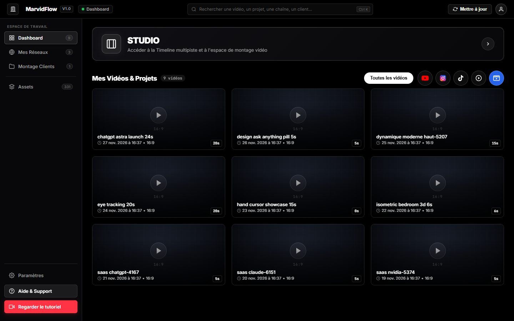
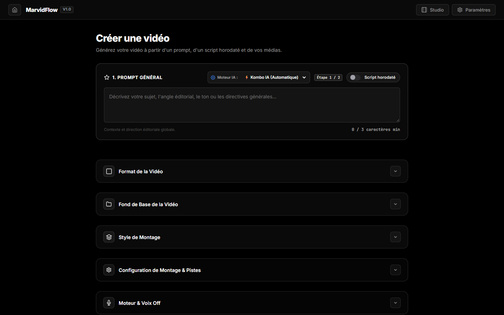

<p align="center">
  
</p>

<h1 align="center">MarvidFlow</h1>

<p align="center">
  <strong>Studio de production et de montage vidéo automatisé par IA</strong><br>
  <em>De l'idée brute au rendu MP4 final : écriture de scénario, voix off studio, animations motion design 60 FPS et montage automatisé (TikTok, Instagram Reels, YouTube Shorts et formats longs).</em>
</p>

<p align="center">
  
  
  
  
  
  
  
</p>

---

## 📸 Aperçu de l'application



---

## 💡 Qu'est-ce que MarvidFlow ?

MarvidFlow est un logiciel complet de production vidéo assisté par intelligence artificielle. Il permet de concevoir, animer et exporter des vidéos percutantes à 60 FPS sans les lourdeurs des logiciels de montage classiques.

L'application répond à deux besoins majeurs :

1. **Génération de vidéos complètes par IA** : Saisissez un sujet ou un texte brut. MarvidFlow génère le scénario, la voix off naturelle (Edge TTS 100% gratuit ou ElevenLabs), les scènes animées, les transitions et les sous-titres dynamiques synchronisés mot à mot (style Hormozi).
2. **Montage automatisé de rushs existants** : Importez vos prises vocales et vidéos brutes. Le moteur découpe automatiquement les silences (`cut_silences`), supprime les mauvaises prises et hésitations (`detect_bad_takes`), recadre au format vertical 9:16 (`auto_reframe`) et applique votre charte graphique.

---

## 🚀 Guide de démarrage rapide (Tester en local)

### Prérequis indispensables

| Prérequis | Version minimale | Rôle dans l'application |
| :--- | :--- | :--- |
| **Node.js** | `v18+` (LTS recommandée) | Moteur d'exécution JavaScript et serveur local |
| **Git** | Dernière version | Clonage et suivi du dépôt |
| **Google Chrome** ou **Edge** | Récent | Moteur de rendu headless (Puppeteer/CDP) & prévisualisation |
| **Python** *(Recommandé)* | `3.8+` | Requis pour **Edge TTS** (voix neuronales gratuites sans clé API) |
| **FFmpeg** | *Inclus via npm* | Encodage MP4 & traitement audio (géré automatiquement par `@ffmpeg-installer`) |

---

### 1. Cloner et installer

Ouvrez un terminal (PowerShell, Bash ou Terminal macOS/Linux) :

```bash
# 1. Cloner le dépôt
git clone https://github.com/NdarawFall/MarvidFlow.git
cd MarvidFlow

# 2. Installer les dépendances du projet
npm install

# 3. (Recommandé) Installer edge-tts pour profiter de la voix off gratuite et illimitée
pip install edge-tts
```

---

### 2. Lancer le studio

```bash
# Démarrer le serveur du studio
npm start
# ou
npm run studio
```

🎉 **C'est tout !** Votre navigateur par défaut s'ouvre automatiquement sur :  
👉 **`http://localhost:3000/09_Pages/home.html`**

---

## 🎙️ Voix off & Synthèse vocale

MarvidFlow propose deux moteurs vocaux puissants configurables selon vos besoins :

### 1. Edge TTS *(100% Gratuit, Illimité, Zéro clé API requise)*
- Utilise les voix neuronales haute fidélité de Microsoft Edge.
- **Idéal pour tester immédiatement sans carte bancaire ni clé API**.
- Voix françaises incluses : **Henri** *(Posé & Documentaire)*, **Vivienne** *(Chaleureuse & Expressive)*, **Rémy** *(Multilingue)*, **Denise**, **Éloïse**.
- Voix anglaises incluses : **Christopher**, **Jenny**, **Guy**, **Aria**, etc.
- Prérequis : avoir exécuté `pip install edge-tts`.

### 2. ElevenLabs *(Qualité Studio & Clonage de Voix)*
- Idéal si vous possédez déjà une clé API ElevenLabs.
- Détection du solde de caractères en temps réel, écoute des voix personnalisées et modèles multilingues v2.

---

## 🔑 Configuration des clés API (Optionnel)

L'application fonctionne immédiatement pour explorer l'interface, les animations, les templates et la synthèse Edge TTS. Pour débloquer la génération complète de scénarios par IA :

Accédez à l'onglet **Paramètres** (icône d'engrenage dans la barre latérale) ou modifiez `07_Scripts/api_config.json` :

- **Google Gemini** : Analyse de script et direction artistique ([Obtenir une clé gratuite sur Google AI Studio](https://aistudio.google.com/app/apikey)).
- **Groq** *(Optionnel)* : Alternative ultra-rapide avec Llama 3.1 ([Obtenir une clé sur groq.com](https://console.groq.com/)).
- **ElevenLabs** *(Optionnel)* : Voix off studio ultra-réaliste ([Obtenir une clé sur elevenlabs.io](https://elevenlabs.io/)).
- **Brandfetch** *(Optionnel)* : Téléchargement automatique de logos vectoriels officiels de marques.
- **Pixabay / Coverr** *(Optionnel)* : Téléchargement de B-rolls et vidéos d'illustration libres de droits.
- **Sketchfab** *(Optionnel)* : Modèles 3D interactifs.

> 🔒 **Sécurité garantie** : Vos clés sont enregistrées en local dans `07_Scripts/api_config.json`. Ce fichier est strictement exclu par `.gitignore` et ne sera jamais envoyé sur GitHub.

---

## 🖥️ Découverte des espaces de travail

### 1. Générateur de vidéo par IA
Configurez votre thème, choisissez le ratio cible (9:16 TikTok/Reels, 16:9 YouTube, 1:1 Carré), définissez la voix off et laissez l'orchestrateur assembler le scénario minuté, les animations et les sous-titres.



---

### 2. Studio de montage et Timeline multipiste
Visualisez la composition avec scrub image par image à 60 FPS.
- **V1 Vidéo / Animations** : Éléments graphiques, scènes 3D Three.js, caméras avec motion blur, B-rolls.
- **CC Sous-titres** : Sous-titres dynamiques synchronisés au mot près (style Hormozi / MrBeast).
- **A1 Voix off** : Narration vocale nettoyée et normalisée (-14 LUFS).
- **A2 Musique & Ambiance** : Piste musicale avec ducking automatique (baisse intelligente sous la voix).
- **A3 Sound Design** : Whooshes, impacts, risers et bruitages synchronisés aux transitions.


---

### 3. Espace Montage Clients et Rushs
Centralisez les projets de vos clients ou de vos chaînes. Déposez des rushs bruts et appliquez automatiquement les chartes graphiques et règles d'édition professionnelle.


---

## 🛠️ Commandes utiles & Scripts

```bash
# Lancer le serveur local du studio
npm start
# ou
npm run studio

# Lancer en application bureau native Windows (Electron)
npm run desktop

# Lancer le rendu d'une vidéo spécifique en ligne de commande
npm run render -- 04_Videos/ma_video.html

# Vérifier la conformité de l'architecture et la traçabilité des fichiers
npm run check:arch

# Nettoyer les fichiers de travail temporaires
npm run clean:scratch

# Compiler l'exécutable d'installation Windows (.exe)
npm run dist
```

---

## 📐 Formats vidéo pris en charge

| Format | Ratio | Résolution standard | Cibles prioritaires |
| :--- | :--- | :--- | :--- |
| **Vertical** | `9:16` | 1080 × 1920 | TikTok, Instagram Reels, YouTube Shorts |
| **Horizontal** | `16:9` | 1920 × 1080 | YouTube, documentaires, tutoriels cinéma |
| **Carré** | `1:1` | 1080 × 1080 | Instagram Feed, LinkedIn, Twitter / X |

---

## ❓ FAQ & Dépannage

<details>
<summary><strong>1. Le port 3000 est déjà utilisé par une autre application</strong></summary>

Vous pouvez spécifier un autre port au lancement :
- **Sous Windows (PowerShell)** :
  ```powershell
  $env:PORT="3001"; npm start
  ```
- **Sous macOS / Linux (Bash)** :
  ```bash
  PORT=3001 npm start
  ```
L'application sera alors accessible sur `http://localhost:3001/09_Pages/home.html`.
</details>

<details>
<summary><strong>2. Erreur lors de la génération de la voix Edge TTS</strong></summary>

Assurez-vous que Python est bien accessible dans votre terminal (`python --version`) et que la bibliothèque `edge-tts` est installée :
```bash
pip install edge-tts
```
Testez en ligne de commande :
```bash
edge-tts --text "Test de voix" --write-media test.mp3
```
</details>

<details>
<summary><strong>3. Chrome ou Chromium introuvable lors du rendu MP4</strong></summary>

Le moteur de rendu utilise Google Chrome ou Microsoft Edge déjà installé sur votre ordinateur. Vérifiez que Chrome ou Edge est installé dans son répertoire par défaut. Sous Linux, vous pouvez installer Chromium via votre gestionnaire de paquets (`sudo apt install chromium-browser`).
</details>

<details>
<summary><strong>4. FFmpeg est-il obligatoire manuellement ?</strong></summary>

Non ! MarvidFlow inclut `@ffmpeg-installer/ffmpeg` dans ses dépendances `npm install`. Si vous disposez déjà d'un binaire `ffmpeg` dans votre PATH système, MarvidFlow le détectera automatiquement en priorité.
</details>

---

## 📁 Architecture du projet

```text
MarvidFlow/
├── 00_Skills/          # Règles d'animation (GSAP), typographie et direction artistique
├── 01_Assets/          # Médiathèque locale (musiques, SFX, logos, polices, B-rolls)
├── 02_Composants/      # Éléments réutilisables (sous-titres dynamiques, badges, split-screens)
├── 03_Chaines/         # Profils de chaînes et Brand Kits (chartes, palettes, polices)
├── 04_Videos/          # Pages HTML interactives des vidéos prêtes pour la prévisualisation et l'export
├── 07_Scripts/         # Moteurs serveur et scripts de traitement :
│   ├── studio-server.cjs   # Serveur HTTP local, API REST et cache mémoire
│   ├── generate_voice.cjs  # Synthèse vocale double moteur (Edge TTS & ElevenLabs)
│   ├── cut_silences.cjs    # Algorithme de découpage automatique des silences
│   ├── detect_bad_takes.cjs# Détection et suppression des hésitations/bafouillages
│   ├── auto_reframe.cjs    # Recadrage automatique intelligent 16:9 vers 9:16
│   └── render.cjs          # Moteur de capture Puppeteer CDP 60 FPS et encodage FFmpeg
├── 08_Rendus/          # Fichiers MP4 finaux exportés (ignoré par Git)
├── 09_Pages/           # Interface utilisateur web du studio (HTML, CSS, JS)
├── Clients/            # Dossiers clients contenant leurs rushs bruts
├── Docs/               # Documentation et captures d'écran de l'application
└── package.json        # Dépendances, scripts et configuration Electron
```

---

## 📄 Licence & Crédits

Projet conçu et développé par **Ndaraw Fall**.  
Distribué sous licence **ISC**.
